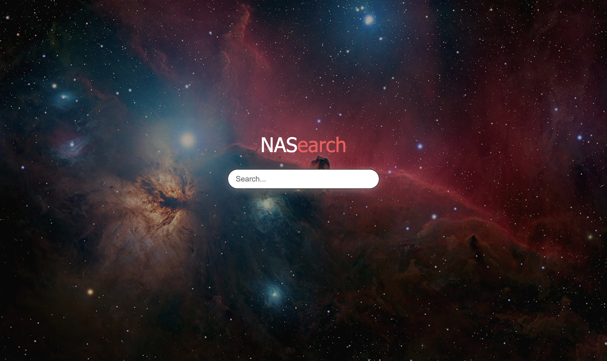
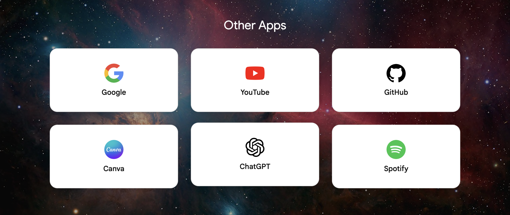
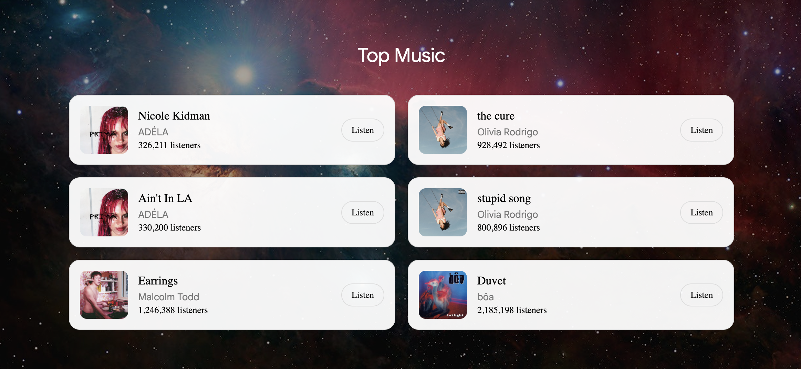

# NASearch

## About

NASearch is a small search engine project I created using HTML, CSS and JavaScript.

The idea was to make a simple search engine a little more interesting by using NASA's Astronomy Picture of the Day as the website background.

## Features

- NASA's Astronomy Picture of the Day as the background.
- Automatically fetches the daily image using NASA's API.

- A navigation section for Top Apps which are used.

- A section to discover the Global Top Music

## Built With

- HTML
- CSS
- JavaScript
- NASA APOD API

## AI Assistance

I used ChatGPT to clear some of my doubts while working on this project, mainly related to CSS and JavaScript.
It helped me understand certain concepts, fix issues.It also helped me with the NASA API.

## What I Learned

I learned nore about CSS ,Javascript and working with API's.

It was a fun project to do, and I will most probably to add more features to it in the future.

---

**Made by Akhil**